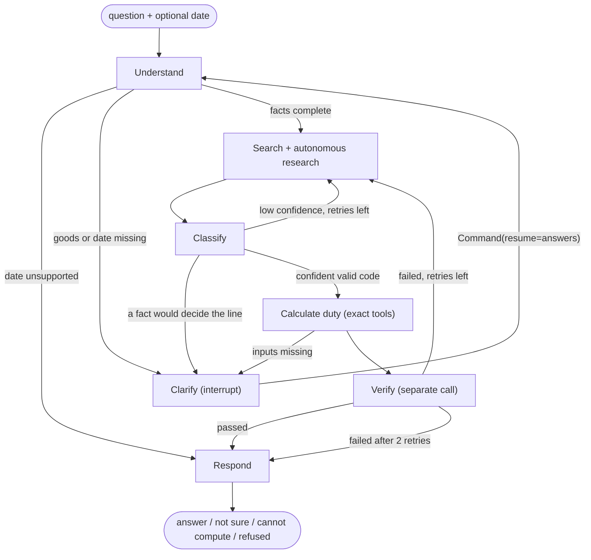
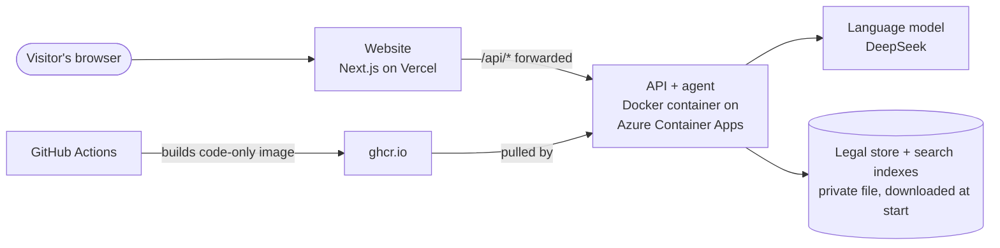

# Customs Copilot (Pakistan)

**Tell it what you are importing, in plain English or Roman Urdu. It finds the 8-digit Pakistan Customs Tariff code, works out the full duty and tax bill for the date you choose, and shows the source of every figure. When it is not sure, it says so instead of guessing.**

[](https://customs-copilot-pi.vercel.app/)
[](LICENSE)

-brightgreen)


> **Independent project. Not an official product.**
> Customs Copilot is **not** a product of, affiliated with, or endorsed by the Federal Board of Revenue (FBR), Pakistan Customs, or the Government of Pakistan. It is built by an independent developer from publicly available FBR documents. It gives **decision support, not legal, tax or customs advice**: classification and duty are decided by Pakistan Customs at assessment. Always confirm with Customs or a licensed customs agent before you rely on a code or a figure. See [DISCLAIMER.md](DISCLAIMER.md).

## Try it

**[customs-copilot-pi.vercel.app](https://customs-copilot-pi.vercel.app/)**, free, no sign-up. Try: *"men's knitted cotton T-shirts, 5,000 pieces, PKR 2,500,000, from China"*. You watch the agent work step by step (understand, search, classify, calculate, verify) and then get the bill with citations. The first question after a quiet period can take about a minute while the server wakes up.

**Contents:** [The problem](#the-problem) · [What it does](#what-it-does) · [How it works](#how-it-works) · [How it is deployed](#how-it-is-deployed) · [How it was tested](#how-it-was-tested) · [What I will test next](#what-i-will-test-next) · [Data and legal position](#data-and-legal-position) · [Run it yourself](#run-it-yourself-optional) · [Known limits](#known-limits)

---

## The problem

Every shipment that enters Pakistan must be declared under one **8-digit tariff code** (the PCT code). The code decides almost everything: the customs duty rate, whether regulatory or additional customs duty applies, the sales tax, the income tax and whether a concession exists. A wrong code means a wrong bill, delays, disputes and sometimes penalties. FBR's own Classification Committee and valuation rulings exist because importers and customs officers disagree about codes.

Why it is hard for a human, and for a plain chatbot:

* **Size.** The FY2026-27 tariff has about 7,600 eight-digit lines under about 1,000 four-digit headings. Many say only "Other".
* **Rules, not words.** Choosing a line means applying the General Rules of Interpretation and the section and chapter legal notes, not matching keywords.
* **The bill is spread over many documents.** The tariff gives only the customs duty. Regulatory duty, additional customs duty, concessions, sales tax and income tax live in separate SROs, schedules and the Finance Act. Several of those SROs are published as scanned images.
* **Everything changes by date.** A rate valid in one fiscal year may not exist in the next, so "what was the rule on 15 September?" must be answered exactly.
* **Language models make things up.** Ask a plain model for a code and a duty rate and it will sound sure while inventing a code, a rate or an SRO number. In customs, a confident wrong answer is worse than no answer.

Free tools exist, but they are mostly keyword lookups for a code you already know. Nobody explains *why* a line was chosen, shows the source of each figure, or admits uncertainty.

## What it does

You describe the goods. The agent:

1. **Understands** the goods and the importer facts you gave, and asks only for what is missing (for example, are you a registered importer, or a manufacturer using this as raw material?).
2. **Researches** the official tariff, the legal notes, SRO clauses, FBR classification decisions and valuation rulings, choosing for itself where to look next.
3. **Classifies** to one real 8-digit line, applying the interpretation rules and the notes.
4. **Calculates** customs duty, regulatory duty, additional customs duty, sales tax, further tax, income tax and federal excise duty, for the date you give, with exact arithmetic.
5. **Verifies** its own answer in a separate check. If it still cannot reach a code it trusts, it says **"I'm not sure"** and shows its top three candidates.

Every figure cites its source: tariff page, SRO number and clause, legal note or ruling. It covers **FY2025-26 and FY2026-27 only**, and the date you pick decides which rules apply.

## How it works

Think of a careful junior customs officer who is never allowed to guess:

| The officer | In this project |
|---|---|
| Keeps a well-organised library where every page is stamped with the dates it applies from and to | **Dated legal store** (SQLite). Every fact row carries `valid_from`, `valid_to`, `source_file` and `page`. |
| Looks things up before answering | **Hybrid search**: exact code lookup, then keyword search (BM25) plus meaning search (bge-small embeddings), merged and re-ranked by a cross-encoder. Four indexes: tariff, legal notes, SRO clauses, rulings. All filtered by date. |
| Decides where to look next | **Autonomous research step**: the agent picks its own actions (search another wording, browse a heading, read a chapter's notes, check rulings). It can widen the shortlist but cannot choose the final code. |
| Uses a calculator, never mental arithmetic | **Exact tools** (`lookup_code`, `get_applicable_sros`, `compute_duty`, also served over MCP). All money maths uses `Decimal`, and every rate comes from the store. The language model never does arithmetic. |
| Is not allowed to make things up | **Guard rails in code**: a proposed code must be 8 digits, must have been returned by a lookup and must exist in the tariff on that date. Any rate, amount, SRO number or page in the answer that is not in the tool output is withheld. Every fact taken from your message needs a quote that really appears in it. |
| Gets a second opinion | **Independent verification**: a separate model call audits the chosen line against the legal notes. A failure sends the agent back to research (at most twice), then to "not sure" mode. |
| Asks when something is missing | **Human in the loop**: clarifying questions pause the graph with LangGraph `interrupt()`, and the conversation resumes with `Command(resume=...)`. |



**Why one graph and not a swarm of agents?** In a legal and tax setting, predictability, a full audit trail and low cost matter more than open-ended autonomy. So the language model decides *what to look at and which line fits*, while plain code does the lookups, the arithmetic and every check. Details: [docs/agent.md](docs/agent.md), [docs/duty_formula.md](docs/duty_formula.md).

## How it is deployed



* The **website** is light, so it lives on Vercel's free plan. The **API** needs about 1 GB of memory for its search models, so it runs in a Docker container on Azure Container Apps (one instance, scales to zero when idle).
* The container image holds **code only**. The built data is derived from FBR publications, so it is **not** in git or in the image; the container downloads it at start from a private link (see [docs/DEPLOY.md](docs/DEPLOY.md)).
* Per-IP rate limits and a hard cap on model calls protect the budget. A question costs roughly 0.1 to 0.5 US cents of model usage.

## How it was tested

Testing has one rule: **report what the numbers really show, with their limits.** Intervals below are 95% Wilson intervals. "Exact line" means the 8-digit code is right on the first choice.

### 1. Real cleared declarations from an importer: a full chapter

An importer (a friend of the author) shared a real extract of cleared **Goods Declarations for the whole of Chapter 85** (electrical machinery and electronics), Karachi and Port Qasim, February 2026: **19,525 lines, 14,950 home-consumption lines, 358 distinct tariff codes**, with the duties Customs actually charged. This is the most realistic test available, because it is everyday importer wording and real assessed duties. The file is private and is **not** in this repository; only anonymised aggregate results are published ([docs/gd_findings.md](docs/gd_findings.md)).

**Classification: 960 real cases** (up to 3 per code, duplicates removed), scored against the *declared* code:

| System | Cases | Right 4-digit heading | Exact 8-digit line, first choice | Right line in top 3 |
|---|---|---|---|---|
| Plain language model, no search | 150 | 58% | 11% (CI 7-17) | 13% |
| Model + search | 150 | 45% | 24% (CI 18-31) | 30% |
| **Full agent** | 150 | 71% | **42%** (CI 34-50) | 57% |
| **Full agent, all cases** | **960** | **72.5%** (CI 70-75) | **43.6%** (CI 41-47) | **56.6%** (CI 53-60) |

Also on all 960: 51.8% exact at 6 digits. The agent paused to ask or said "not sure" on 547 of the 960 cases; because nobody answers in an automated test, those are scored by the candidates it showed.

How to read this honestly: the label is what the importer *declared*, not what an expert confirmed. The file itself shows how noisy declared codes are. When different importers typed the same description, they used the **same 8-digit code only 72%** of the time, so even a perfect majority-vote system would match the declared code on only about 91% of those lines. 43.6% is therefore a lower bound against the truth, not a measure of how often the agent is wrong. It is also far from replacing a customs expert, and the repository says so.

**Duty arithmetic against what Customs actually charged** (1,500 random lines):

* On lines with no concession, **678 of 770 (88%)** matched Customs on every tax (customs duty, regulatory duty, additional customs duty, sales tax, the 3% value-addition tax and income tax within 2 rupees).
* The real assessments exposed rules that the Act text alone did not make clear, for example an extra sales-tax amount charged to unregistered importers. Adding it raised the match from 84% to 88%. Rules we could not confirm (such as a manufacturer's own-use rate) are offered as a *possible rule* with a warning and **never applied silently**.
* Concession lines were used to build and check the China FTA schedule: once the amended table (SRO 1181(I)/2022) was loaded, **95.8% (5,259 of 5,491)** of China FTA lines matched the duty actually charged, up from 77.6%.
* Findings we could not explain yet are listed openly, for example an 11% additional customs duty on about ten automotive electrical codes that no notification we hold supports.

### 2. Real FBR classification rulings

79 cases built from FBR's public classification rulings (70 with an 8-digit answer). These are **mostly disputed goods**, so this is a stress test, not a typical day.

| System | Right 4-digit heading | Exact 8-digit line | Right line in top 3 |
|---|---|---|---|
| Plain language model | 66% | 26% (CI 17-37) | 34% |
| Model + search | 52% | 34% (CI 24-46) | 43% |
| **Full agent** | 68% | **54%** (CI 43-65) | 73% |
| Open-source TariffAI baseline (6-digit codes only) | 49% | not possible | not possible |

The agent was improved in numbered versions (v0 to v4), each compared on the same cases, so every change had to earn its place: [docs/eval_versions.md](docs/eval_versions.md).

### 3. A catalogue test across 93 chapters, with a held-out split

Real office cases were not available, so a catalogue set walks the whole tariff: one everyday description for each of 279 randomly sampled tariff lines in 93 chapters, written by an AI. The cases are split by 4-digit heading into 193 **dev** cases (used for tuning) and 86 **test** cases that were **never tuned on** and run once.

| System | Cases | Exact line, first choice |
|---|---|---|
| Plain language model | 60 (dev) | 43% |
| Model + search | 60 (dev) | 78% |
| **Full agent** | 60 (dev) | **95%** |
| **Full agent, held-out** | 86 (test) | **91%** (CI 83-95), right heading 94% |

Without any language model, the search shortlist already contains the right line for 90% of dev and 91% of test cases. That is the ceiling for the classification step. These descriptions are clean and written by an AI that saw the tariff wording, so real input scores lower, as sections 1 and 2 show.

### 4. Other checks

* **Official WeBOC calculator.** For 33 tariff codes the tool could compute, **30 match the official calculator** to the rupee on every duty and sales-tax amount. The 3 that differ are vehicle parts with the unexplained 11% additional duty above. WeBOC shows an income-tax *rate* that depends on importer status, so that is compared separately ([docs/weboc_comparison.md](docs/weboc_comparison.md)).
* **Ablations.** The graph, not the model, drives the gain. A newer model (DeepSeek V4.1 Flash) made no measurable difference on 100 paired cases. The autonomous research step also made no measurable difference on the catalogue set, so it is kept but **not** claimed as an accuracy gain.
* **A test that failed on purpose.** A blind AI "second reader" was calibrated on cases with known answers. It scored 52%, a coin flip, so its verdicts were **discarded**, not used.
* **Software tests.** 554 automated tests with a scripted fake language model (no network, no cost). They cover the tools, the guard rails, the graph, streaming, the sanitiser and the security rules.
* **Live end-to-end check.** After deployment, a real question was sent through the public website: it was understood, classified to 6109.1000 with 96/100 confidence and the agent then asked the follow-up questions it needed for the bill.

### Limits of all of the above

The test sets are **small, partly AI-written, and not verified by a customs expert**. The importer extract is **one chapter, one month, one source**, and its labels are declared codes, not confirmed ones. The ruling set is mostly disputes. Treat every figure as an engineering measurement, not a promise of accuracy.

## What I will test next

Planned, **not yet done**, in rough priority order:

1. **Expert review.** Ask a customs practitioner to check a sample of the catalogue labels (88 of 279 are marked uncertain) and a sample of the agent's answers, to replace declared codes with verified ones.
2. **More real data.** Extend the declaration test beyond Chapter 85 to textiles and other chapters, and add cases from a clearing agent's office. The evaluation harness already takes new cases.
3. **Real usage.** Use the live beta's opt-in feedback to measure how often the final code was right for real users.
4. **Re-run baselines** on all 960 importer cases (they were run on 150) and compare against a larger model.
5. **Harder goods.** Test whether the research step helps on terse, noisy descriptions, where the clean catalogue could not show a difference.
6. **Open duty questions.** Resolve the 11% additional customs duty with a clearing agent or FBR, and handle mobile phones and electric vehicles, which the tool currently refuses to compute rather than guess.
7. **Live-site checks.** Walk the pre-launch security checklist ([docs/security.md](docs/security.md)) against the deployed site and add a small load test.

## Data and legal position

* **Code**: MIT licensed ([LICENSE](LICENSE)).
* **FBR documents are not redistributed here.** The tariff, SROs, Acts, rulings and public notices are publications of the Government of Pakistan. This repository holds the code that reads them and documentation of how, not the documents or tables derived from them. You build the data store yourself from the official PDFs (sources and links: [docs/sources.md](docs/sources.md)).
* No FBR or government logo, emblem or branding is used. "FBR", "Pakistan Customs" and "WeBOC" are named only to say what the tool works with.
* Evaluation cases written by the author, and cases paraphrased from public rulings, are in `data/ground_truth/` with their sources.
* The private importer extract was used for evaluation only. It is not in this repository; the documentation holds anonymised aggregate results (no names, tax numbers or declaration numbers).

## Tech stack

| Area | Choices |
|---|---|
| Agent | Python 3.13, LangGraph (state graph, `interrupt`, checkpointer: in memory on the live site so product text is never written to disk, SQLite optional on the command line), MCP tool server |
| Retrieval | rank-bm25, fastembed (bge-small-en-v1.5, ONNX), cross-encoder re-ranking (MiniLM), reciprocal rank fusion |
| Data | SQLite dated legal store, PyMuPDF and pdfplumber, vision-model reading of scanned SROs with validators |
| LLMs | Adapters for DeepSeek (default), Google Gemini, Fireworks and OpenRouter, with caching, quotas and call caps |
| API | FastAPI, NDJSON streaming, rate limiting, body limits, strict security headers |
| Web | Next.js 16, React 19, TypeScript, Tailwind 4, Three.js scroll story, strict Content-Security-Policy |
| Deploy | Docker, GitHub Actions, GitHub Container Registry, Azure Container Apps, Vercel |
| Quality | 554 tests, evaluation harness with ablations, baselines and a held-out split |

## Run it yourself (optional)

The repository holds the code, not the FBR documents or tables derived from them, so you build the data once from the official PDFs.

```bash
# 1. Python environment
python -m venv .venv && .venv/Scripts/pip install -r requirements.txt     # Linux/macOS: .venv/bin/pip
cp .env.example .env                                                     # add DEEPSEEK_API_KEY (or GEMINI_API_KEY)

# 2. Build the data from the official FBR PDFs (see docs/sources.md for what goes in data/raw/)
python -m src.store.build            # dated legal store
python -m src.search.build           # search indexes (about 10 minutes on CPU)

# 3. Ask from the command line
python -m src.agent "men's cotton T-shirts, 5,000 pieces, value PKR 2,500,000, registered importer" --date 2026-09-15

# 4. Run the website
python -m src.api                    # API on 127.0.0.1:8000
cd web && npm install && npm run dev # website on 127.0.0.1:3000
```

Tests: `python -m pytest -q`. Tests that need the built data are skipped, with a reason, until you have built it (all 554 pass with the data present). Evaluation: `python -m src.eval.run --help`; retrieval-only check: `python -m src.eval.retrieval_eval --split dev`.

## Repository map

```
src/ingest/   reading FBR PDFs: tariff, SROs (vision + validators), Acts, schedules, rulings
src/store/    dated legal store (SQLite) and its loaders
src/search/   hybrid search indexes
src/tools/    lookup_code, get_applicable_sros, compute_duty (exact), MCP server
src/agent/    the LangGraph agent, research step, LLM adapters, guard rails
src/api/      FastAPI service, security, sanitiser for user-facing text
src/eval/     evaluation harness, catalogue test set, baselines
web/          Next.js website
deploy/       Docker start script, data packer, Azure deploy script
docs/         design notes, findings per source, evaluation reports, security design
tests/        554 tests
```

## Known limits

* FY2025-26 and FY2026-27 only. Mobile phones, electric vehicles and some sugar rules are refused rather than guessed. Customs-duty concessions covered: Fifth Schedule and China FTA Phase II.
* Legal notes are the HS 2022 text printed in the Pakistan tariff; their applicability to both fiscal years is assumed.
* SROs are scans read by a vision model and then validated; some rows are flagged for human review.
* The language model is not deterministic across providers; re-run the evaluation when you change it.
* **Privacy:** what you type is sent to the language-model provider (DeepSeek, whose servers are outside Pakistan). Do not enter names, phone numbers or other personal data.

## Security

The API never stores what users type except feedback they choose to send, applies rate limits and a daily call budget, and the website runs under a strict Content-Security-Policy. Details and the pre-launch checklist: [docs/security.md](docs/security.md). Report problems privately through GitHub security advisories ([SECURITY.md](SECURITY.md)).

## Author

Built by **Maaz Ahmed** ([@Maaz5711](https://github.com/Maaz5711)). Feedback from customs practitioners is very welcome: open an issue.
