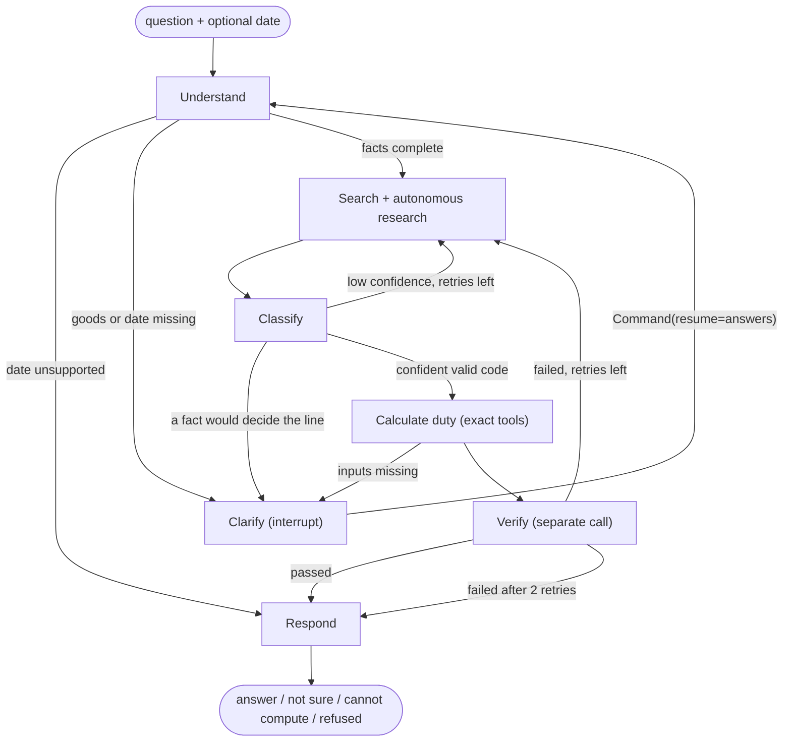

# Customs Copilot (Pakistan)

**An AI agent that finds the 8-digit Pakistan Customs Tariff (PCT) code for a product described in plain words, then works out the full import duty bill with a citation for every figure.**

[](LICENSE)


> **Independent project. Not an official product.**
> Customs Copilot is **not** a product of, affiliated with, or endorsed by the Federal Board of Revenue (FBR), Pakistan Customs, or the Government of Pakistan. It is built by an independent developer from publicly available FBR documents. It gives **decision support, not legal, tax or customs advice**: classification and duty are decided by Pakistan Customs at assessment. Always confirm with Customs or a licensed customs agent before you rely on a code or a figure. See [DISCLAIMER.md](DISCLAIMER.md).

## What it does

You write what you are importing, in English or Roman Urdu: *"men's cotton T-shirts, 5,000 pieces, value PKR 2,500,000"*. The agent:

1. **Understands** the goods and the importer facts you gave, and asks only for what is missing.
2. **Researches** the official tariff, the legal notes, FBR classification decisions and valuation rulings, choosing for itself where to look next.
3. **Classifies** to one of the real 8-digit lines, applying the General Rules of Interpretation and the chapter and section notes.
4. **Calculates** customs duty, regulatory duty, additional customs duty, sales tax, further tax, income tax and federal excise duty for the date you give, with exact arithmetic.
5. **Verifies** its own answer with a separate check, and says **"I'm not sure"** with its top three candidates when it cannot reach a code it trusts. It never invents a code, a rate or an SRO number.

Every line of the answer cites its source: tariff page, SRO number and clause, legal note, or ruling.

Covers **FY2025-26 and FY2026-27 only** (rules are stored with the dates they apply from and to, so the answer depends on the date you ask about).

## Why this is more than "RAG"

| Layer | What it does |
|---|---|
| **Dated legal store** | SQLite store where every fact row carries `valid_from`, `valid_to`, `source_file` and `page`. "Which rule applied on date X" is answered by code, never by the language model. |
| **Hybrid retrieval** | Exact code lookup, then BM25 plus dense search (bge-small), fused by reciprocal rank fusion and re-ranked by a cross-encoder. Four indexes: tariff, legal notes, SRO clauses, rulings. Everything is filtered by date. |
| **Autonomous research** | After the first retrieval the agent picks its own actions (search another wording, browse a heading, read a chapter's notes, check rulings) and sees each result before the next. It only widens the pool; it cannot choose the final code. |
| **Exact tools** | `lookup_code`, `get_applicable_sros` and `compute_duty` (also served over MCP). All duty arithmetic uses `Decimal`; every rate comes from the store. |
| **Guard rails in code** | A proposed code must be 8 digits, must have been returned by a lookup, and must exist in the tariff on that date. Any rate, amount, SRO number or page in the text that is not in the tool output is withheld. Each fact extracted from your message needs a quote that really appears in it. |
| **Independent verification** | A separate model call audits the chosen line against the legal notes. Failure sends the agent back to research (at most twice), then to "not sure" mode. |
| **Human in the loop** | Clarifying questions pause the graph with LangGraph `interrupt()`; the conversation resumes with `Command(resume=...)`, saved in a SQLite checkpointer. |

### Architecture



Design note: one orchestrating graph with specialised nodes and plain tools, not a swarm of free-roaming agents. In a legal and tax setting predictability, a full audit trail and low cost matter more than open-ended autonomy, so the language model decides *what to look at and which line fits*, while code does lookups, arithmetic and every check. Details: [docs/agent.md](docs/agent.md).

## Measured results (read the limits)

All numbers come from this repository's own evaluation ([docs/eval_versions.md](docs/eval_versions.md), [docs/catalog_eval.md](docs/catalog_eval.md), [docs/gd_findings.md](docs/gd_findings.md)). Test sets are **small, partly written by an AI and not verified by a customs expert**, and the real set comes from public rulings (mostly disputed goods). Intervals are 95% Wilson.

| Test | n | Exact 8-digit line, first choice | Notes |
|---|---|---|---|
| Plain LLM (no search) | 70 | 26% | baseline on the real-ruling set |
| LLM + search | 70 | 34% | baseline |
| **Full agent** | 70 | **54%** (CI 43-65); right line in top 3: 73% | same cases, same model |
| Real cleared Goods Declaration lines, Chapter 85 | 960 | 43.6%; right 4-digit heading 72.5% | scored against *declared* codes, which are themselves noisy |
| Duty arithmetic vs FBR's WeBOC calculator | 33 codes | CD, RD, ACD, sales tax (and FED) match to the rupee on **30** | 3 vehicle-part codes differ (open question) |
| Everyday goods across 93 chapters, plain LLM / LLM + search / **full agent** | 60 (same cases) | 43% / 78% / **95%** | AI-written, unverified labels, clean descriptions |
| Same agent on the **held-out test split** (run once, never tuned on) | 86 | **91%** (CI 83-95) | right 4-digit heading 94% |
| Search shortlist holds the right line (no LLM) | 193 dev / 86 test | 90% / 91% | the ceiling for the classification step |

Honest reading: the agent clearly beats a plain model and a search-only model on the same cases. The 91-95% on everyday goods comes from clean, AI-written descriptions; on real, terse importer text it is far lower (43.6% on real declaration lines, 54% on disputed rulings), so it is not accurate enough to replace a customs expert. The autonomous research step made no measurable difference on the everyday-goods set (details in [docs/catalog_eval.md](docs/catalog_eval.md)). More data (office-cleared cases, amendments to FBR notifications) is the main lever, and the evaluation harness is built to take it.

## Data and legal position

* **Code**: MIT licensed ([LICENSE](LICENSE)).
* **FBR documents are not redistributed here.** The tariff, SROs, Acts, rulings and public notices are publications of the Government of Pakistan. This repository holds the code that reads them and the documentation of how, not the documents or tables derived from them. You build the data store yourself from the official PDFs (sources and links: [docs/sources.md](docs/sources.md)).
* No FBR or government logo, emblem or branding is used. "FBR", "Pakistan Customs" and "WeBOC" are named only to say what the tool works with.
* Evaluation cases written by the author, and cases paraphrased from public rulings, are in `data/ground_truth/` with their sources.
* A private importer's cleared-declaration extract was used for evaluation only. It is not in this repository; the documentation contains anonymised aggregate results (no names, tax numbers or declaration numbers).

## Tech stack

| Area | Choices |
|---|---|
| Agent | Python 3.13, LangGraph (state graph, `interrupt`, SQLite checkpointer), MCP tool server |
| Retrieval | rank-bm25, fastembed (bge-small-en-v1.5, ONNX), cross-encoder re-ranking (MiniLM), reciprocal rank fusion |
| Data | SQLite dated legal store, PyMuPDF and pdfplumber, vision-model reading of scanned SROs with validators |
| LLMs | Provider adapters for DeepSeek (default), Google Gemini, Fireworks and OpenRouter, with caching, quotas and call caps |
| API | FastAPI, rate limiting, body limits, strict security headers |
| Web | Next.js 16, React 19, TypeScript, Tailwind 4, Three.js scroll story, strict Content-Security-Policy |
| Quality | 547 tests (scripted fake LLM, no network), evaluation harness with ablations and a baseline |

## Quick start

```bash
# 1. Python environment
python -m venv .venv && .venv/Scripts/pip install -r requirements.txt     # Linux/macOS: .venv/bin/pip
cp .env.example .env                                                     # add DEEPSEEK_API_KEY (or GEMINI_API_KEY)

# 2. Build the data from the official FBR PDFs (see docs/sources.md for what goes in data/raw/)
python -m src.store.build            # dated legal store
python -m src.search.build           # search indexes (about 10 minutes on CPU)

# 3. Ask from the command line
python -m src.agent "men's cotton T-shirts, 5,000 pieces, value PKR 2,500,000, registered importer" --date 2026-09-15

# 4. Run the website
python -m src.api                    # API on 127.0.0.1:8000
cd web && npm install && npm run dev # website on 127.0.0.1:3000
```

Tests: `python -m pytest -q`. Evaluation: `python -m src.eval.run --help`, retrieval-only check: `python -m src.eval.retrieval_eval --split dev`.

## Repository map

```
src/ingest/   reading FBR PDFs: tariff, SROs (vision + validators), Acts, schedules, rulings
src/store/    dated legal store (SQLite) and its loaders
src/search/   hybrid search indexes
src/tools/    lookup_code, get_applicable_sros, compute_duty (exact), MCP server
src/agent/    the LangGraph agent, research step, LLM adapters, guard rails
src/api/      FastAPI service, security, sanitiser for user-facing text
src/eval/     evaluation harness, catalogue test set, baselines
web/          Next.js website
docs/         design notes, findings per source, evaluation reports, security design
tests/        547 tests
```

## Known limits

* FY2025-26 and FY2026-27 only. Mobile phones, electric vehicles and some sugar rules are refused rather than guessed. Customs-duty concessions covered: Fifth Schedule and China FTA Phase II.
* Legal notes are the HS 2022 text printed in the Pakistan tariff; their applicability to both fiscal years is assumed.
* SROs are scans read by a vision model and validated; some rows are flagged for human review.
* The language model is not deterministic across providers; rerun the evaluation when you change it.

## Security and privacy

The API never stores what users type except feedback they choose to send, applies rate limits and a daily call budget, and the website runs under a strict Content-Security-Policy. Details and the pre-launch checklist: [docs/security.md](docs/security.md). Report problems privately through GitHub security advisories ([SECURITY.md](SECURITY.md)).

## Author

Built by **Maaz Ahmed** ([@Maaz5711](https://github.com/Maaz5711)). Feedback from customs practitioners is very welcome; open an issue.
