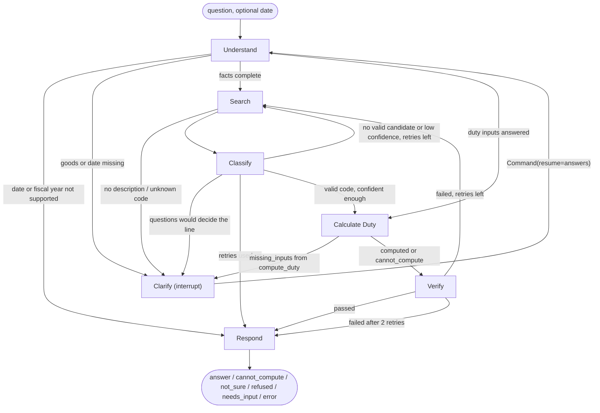

# The question-time agent (C1)

Package: `src/agent/`. Run: `python -m src.agent`. Tests: `tests/test_agent*.py` (127 tests, all with a scripted `FakeLLM`, no network).
Build notes, live smoke test and problems found: `docs/agent_notes.md`. Exact tools it calls: `docs/tools.md`. Search it uses: `docs/search_notes.md`.

The agent takes a product description (and optionally a date), asks what it still needs, finds candidate PCT codes, checks them against
the legal notes, gets the duty bill from the exact tools for that date, checks its own answer with a separate LLM call, and replies with
citations. If it cannot get to a code it trusts after 2 retries it says "I'm not sure" and shows the top 3 candidates.
Results are decision support, not legal advice.

## Run it

```
python -m src.agent                                    # interactive: type a product, answer its questions
python -m src.agent "men's cotton T-shirts, 10,000 pieces, value PKR 2,500,000, registered commercial importer" --date 2026-07-15
python -m src.agent "laptops" --date 2026-07-15 --db data/processed/cache/agent_threads.sqlite --thread demo1     # not a terminal: prints questions, stops (exit 2)
python -m src.agent --db data/processed/cache/agent_threads.sqlite --thread demo1 --answer as_of_date=2026-07-15 --answer importer.registration_status=registered
python -m src.agent --list-models                      # which Gemini models this key can use (does not use generation quota)
python -m src.agent "..." --debug --max-llm-calls 5    # node path, LLM usage; hard cap on LIVE calls
python -m src.agent "..." --tools mcp                  # the exact tools through the MCP server (stdio) instead of in-process
```
`.env` must contain `GEMINI_API_KEY=...` (gitignored). Dependencies: `pip install -r requirements.txt` (adds `langgraph`, `langgraph-checkpoint-sqlite`).
The agent never assumes today's date: give `--date`, write a date in the question, or it asks.

From Python:
```python
from src.agent import CustomsAgent, GeminiLLM
agent = CustomsAgent(GeminiLLM())
turn = agent.ask("laptop computers", as_of_date="2026-07-15")
while turn.interrupt:                                   # paused by Clarify: turn.interrupt["questions"] = [{id, question, why, allowed, type, error?}, ...]
    turn = agent.resume(turn.thread_id, {"answers": {"assessable_value_pkr": "1,000,000", ...}})    # or a plain string for one question
print(turn.final["text"], turn.final["status"], turn.final["bill"], turn.final["citations"])
```

## Graph



| Node | Uses an LLM? | What it does |
|---|---|---|
| Understand | yes, once per question | The LLM returns the facts it finds **as quotes from the message** (goods, material, new/used, CKD/CBU, engine text, value text, quantity text, registered or not, commercial importer, date text, codes). Code keeps a fact only if its quote really is in the message, then reads the number or date itself (`parsing.py`: "10 lakh", "2.5 million", "15 July 2026"). A date outside 1 Jul 2025 to 30 Jun 2027 or an unsupported fiscal year is refused before any search. A missing date is asked, never assumed (the word "today" is accepted only if the user wrote it). After a Clarify it reads the answers deterministically (typed by field); free text for several questions at once is mapped by one small LLM call, then read by code. |
| Clarify | no | `interrupt({type, kind, round, message, questions, notes})`. Resumes with `Command(resume=...)`. Three kinds: `request` (goods, date), `classification` (questions the classifier says would decide between candidates), `duty_input` (what `compute_duty` reports in `missing_inputs`, all stages in one round). Unreadable answers are asked again with the reason (max 2 times); "I don't know" ends in `needs_input` (no bill). |
| Search | no | `src.search` is called per index (tariff, notes, SRO, rulings) with `as_of_date` and a score floor on the cross-encoder `rerank_score`; exact-code queries go direct. Adds the lines of the best 2 headings (if 30 lines or fewer), chapter notes + section notes + GRI 1-6, and PCT codes quoted in a relevant ruling. See `docs/agent_notes.md` for the floors. |
| Classify | yes | The LLM chooses among the offered lines only (labels T1..), applying GRI and the notes (N1..), and returns up to 3 candidates with confidence, reasons and the labels it relied on, plus questions if the choice depends on a missing fact. Code then keeps a candidate only if it is an eight-digit code, was offered, and `lookup_code` finds it on the date. Reasons are checked by the grounding check (below). |
| Calculate Duty | no | `lookup_code`, `compute_duty`, `get_applicable_sros` from `src.tools` (in-process or via MCP). Nothing here is computed by the agent. If something is missing it asks all of it in one round (see "Missing inputs"). |
| Verify | yes (one separate call) | Exact checks plus an independent LLM audit, see below. A failure goes back to Search (retry), at most 2 times. |
| Respond | no | Plain code builds the answer from the tool output: itemised bill, SRO number and clause, file and page for every line, every flag and assumption, what is not verified, citations, the disclaimer. |

## State (`AgentState` in `nodes.py`)
| Field | Set by | Meaning |
|---|---|---|
| `question`, `date_arg` | caller | the user's text; an explicit date (never assumed) |
| `facts` | Understand | goods description, material, intended use, condition, vehicle form, engine cc, value/quantity text, value or engine issues |
| `inputs` | Understand, Clarify answers | nested compute_duty inputs: `assessable_value_pkr`, `quantity`, `quantity_unit`, `importer{}`, `goods{}` (numbers are strings) |
| `as_of_date`, `date_source` | Understand | ISO date and where it came from (argument, message quote, answer, "you wrote today") |
| `user_codes`, `user_code_only` | Understand, Search | codes the user wrote (vetted against the tariff); a lone 8-digit code skips Classify and the LLM fit check |
| `notes_to_user` | Search | for example "the code you wrote is not a line of the tariff"; printed at the top of the answer |
| `clarifications` | Understand | `[{question, answer, kind, unknown}]` for classification questions (shown to Classify/Verify; "ALREADY ASKED") |
| `pending_questions`, `pending_answer`, `clarify_kind`, `clarify_rounds` | nodes / Clarify | the open questions, the resume value, the kind, rounds used (max 4) |
| `reask`, `unknown_fields`, `unresolved` | Understand | re-ask counters, fields the user does not know, what is still missing when the run ends in `needs_input` |
| `evidence`, `offered_codes`, `extra_queries`, `retry_pending` | Search / Verify | labelled lines, notes, SRO excerpts, rulings (JSON); retry search phrases from the classifier or the auditor |
| `candidates`, `rejected_codes`, `deciding_info`, `chosen_code` | Classify | validated top 3 with confidence and reasons; every rejected LLM code with the reason; what would decide |
| `lookup`, `duty`, `rules_in_force` | Calculate | the tool outputs (JSON), and the RD/ACD/ST/IT notifications in force on the date |
| `verification`, `retries`, `feedback`, `attempts` | Verify | checks, issues, warnings; retries used (max 2); feedback text for the next Classify; log of every attempt |
| `route`, `mode` | every node | next node; `answer`, `cannot_compute`, `not_sure`, `refused`, `error`, `needs_input` |
| `not_sure_reason`, `refusal`, `error`, `final` | | why "not sure"; why refused; the error message; the answer dict |
| `trace`, `llm_log` | every node (append) | one line per node step; which model answered each LLM call (`task:model:live|cached`) |

`final` = `{status, text, code, description, as_of_date, confidence, candidates[], bill{lines, totals, optional_lines_not_in_total}, citations[], flags[], assumptions[], unverified[], verification, disclaimer, trace}`.
All state is JSON, so a SQLite checkpointer (`--db`) can keep a paused conversation across runs.

## How the hard rules are enforced
| Rule | Mechanism | Test |
|---|---|---|
| The LLM never states a rate or does arithmetic | Every amount and rate in the text is copied from the `compute_duty` result; the answer is rendered by `respond.py` with no LLM. LLM-written text (candidate reasons, auditor notes) must pass `ground.py`: any rate, amount, SRO number, page, PCT code or note citation that is not in the tool output / retrieved evidence / user message replaces the text with "(text withheld ...)". The final answer is checked again before it is returned; a failure becomes an `error`, never a number. | `test_answer_numbers_equal_tool_output_and_invented_figures_are_blocked`, `test_ground_check_flags_every_kind_of_invented_citation` |
| Never a code that is not retrieved / not in the tariff | `validate_candidates`: eight digits, among the offered lines, `lookup_code` found on the date. Rejected codes never reach the calculator, the auditor or the answer. | `test_invalid_llm_codes_are_rejected_and_never_shown`, `test_validate_candidates_checks_digits_offer_and_tariff` |
| "I'm not sure" + top 3 after 2 retries | `Config.max_retries = 2` for Verify failures and for low confidence / no valid candidate; then `not_sure` mode with the top 3 candidates, their reasons and what would decide. No bill. | `test_not_sure_mode_after_two_failed_verifications`, `test_low_confidence_retries_then_says_not_sure_without_calling_verify` |
| Ask, do not guess | `missing_inputs` from `compute_duty` become Clarify questions; no total exists until the tool returns `computed`. | `test_missing_inputs_trigger_clarify_instead_of_a_number` |
| Never silently assume today; only the two supported years | `understand` refuses dates outside the store's coverage and unsupported fiscal years (no search, no tool call, no LLM call when the date is an argument); a missing date is asked. | `test_unsupported_date_is_refused_before_any_search_or_calculation`, `test_missing_date_is_asked_never_assumed_to_be_today` |
| Verify is a separate call | its own prompt and its own LLM call (task `verify`); it sees the facts, the chosen line and the notes, not the classifier's confidence. | `test_happy_path_gives_bill_citations_flags_and_disclaimer` |
| An LLM cannot make up the user's facts | each extracted fact needs a quote found in the message; the value must be PKR (no conversion); units are never converted. | `test_hallucinated_value_without_a_quote_in_the_message_is_dropped`, `test_value_in_dollars_is_asked_in_rupees_not_converted` |
| Keys stay out of git, logs and cache | the key is read from `.env`/environment at call time and appears in no log, error, stats or cache file. | `test_key_never_appears_in_errors_stats_or_cache` |

## Verify (what is checked)
Exact checks (no LLM): the chosen code is an eight-digit line valid on the date; the bill's totals equal the sum of its lines (Decimal); every line has instrument, clause, file, page and dates; every rate, amount, SRO number, page, code and note citation in the answer text is found in the tool output or sources.
Independent LLM audit (own prompt; sees the facts, the chosen line, the notes of the chosen code's chapter and section, GRI): does the line fit the goods, does any legal note contradict it (note labels it cites must exist, otherwise ignored with a warning), which claims are unsupported, a better search phrase.
Pass = exact checks pass and `fits` with `fit_confidence >= 0.5` and no real contradicting note. Warnings (unchecked conditions, unsupported claims) are printed in the answer under CHECKS RUN.

## Missing inputs (all stages in one round)
`compute_duty` reports missing inputs stage by stage (for a car the income-tax question appears only after the vehicle questions are answered). To avoid several rounds, `discover_missing` calls the tool again with a stand-in answer for each missing field until it asks nothing new. If the value is also missing it is probed with 1 PKR. **The stand-in numbers are never stored or shown**; only the list of questions is kept (`test_clarify_interrupt_resume_round_trip` checks `duty` is empty at that point). The real call is made only with the user's own answers.

## LLM layer (`llm.py`)
* `LLM.complete_json(task, system, prompt)` returns parsed JSON. Providers: `GeminiLLM` and `FakeLLM`; `make_llm("name")`. To add a provider write a class with the same method, raise the `LLMError` subclasses, register it in `PROVIDERS`.
* Gemini: REST, `responseMimeType: application/json`, temperature 0. Models in order (`GEMINI_MODELS` env or `--models` override): gemini-3.5-flash, gemini-3-flash-preview, gemini-3.6-flash, gemini-3.7-flash, gemini-3.8-flash, gemini-3.5-flash-lite, gemini-3.1-flash-lite. Each name has its own free quota.
* Cache: `data/processed/cache/llm/` (gitignored), key = hash of task, system, prompt, temperature (not the model). Same question again = no request. `--max-llm-calls 0` replays only from the cache and fails safely on a miss.
* 429: a daily limit marks the model out until the next midnight Pacific time (kept in `data/processed/cache/gemini_quota.json`, so the next run skips it without a request); a per-minute limit waits `retryDelay` if it is 25 s or less, otherwise falls back to the next model. All models out of quota: `LLMRateLimited` with the reset time and per-model reasons, shown to the user as an `error` answer ("Nothing was computed"). `GEMINI_IGNORE_QUOTA_BOOK=1` ignores the book.
* 503/overload, timeouts, bad JSON: one retry, then the next model; a model that just failed is tried last for 90 s. 404 (retired or unavailable model): tried last for an hour. A bad key is a clear `LLMUnavailable`.
* `max_calls` caps LIVE (HTTP 200) calls per process; failed requests are capped separately.

## Customs-duty concessions (Fifth Schedule, China FTA): what the agent asks and shows
Nothing here is decided by the LLM. `compute_duty` returns a `concessions` block (options, bills with and without, conditions it cannot check, `questions`); the Calculate node only turns those into questions and the Respond node only prints them.
* **When it asks.** After a bill was computed (status `computed`) and a concession row exists for the chosen code on the date: (1) goods of any code that has a China FTA row and no `goods.origin_country` yet: "In which country were the goods produced (not shipped from)?"; (2) origin China and no certificate answer yet: "Do you hold a valid Certificate of Origin (Form E)?"; (3) origin China and certificate yes: "Do you want the bill calculated with the China FTA rate (X% printed for that year, customs duty Y% instead of Z%)? You must be able to show the certificate" (sets `goods.claim_china_fta`); (4) for the first two Fifth Schedule options: "The Fifth Schedule (Part I, S.No ...) lists R%, which would make the customs duty Y% instead of Z%. Does the importer meet its conditions? Conditions (not checked by me): ..." (field `claim.<rule_id>`, yes = claimed). At most 3 questions in one round, each field asked once per conversation; "I don't know" or "no" is never a claim. No question is asked when the bill is partial (`cannot_compute`) or the clarify rounds are used up.
* **What it prints.** Not claimed: the normal bill, then `CUSTOMS-DUTY CONCESSIONS THAT MIGHT APPLY (NOT applied ...)` with up to 4 options: printed rate, customs duty with vs without, the bill total with it and the difference, the conditions it cannot check, source file and page. Claimed: the bill WITH the concession as the main bill (its CD line cites the concession row), plus `CUSTOMS-DUTY CONCESSION APPLIED (because you claimed it)`, the total WITHOUT it, and the unchecked conditions. Concession citations are added to SOURCES.
* **State.** `concession_asked` (list of fields already asked). Claims are kept in `inputs["claim"]` and passed to the tool as `claimed_rules`; `goods.claim_china_fta` goes in `goods`.
* **Limits.** The agent does not read the importer's documents: origin, Form E, certificates and local-manufacture status are the importer's word. Part I entries named only in words ("Respective Headings") are mentioned, not matched.

## Limits (read before relying on it)
* One product per question. Several products: it asks which one first.
* The classifier only sees what search retrieves (about 10-35 lines). For very large headings (8703 has 103 lines) it relies on questions and the answers joining the search query; a correct line that is never retrieved cannot be chosen.
* The model's confidence is its own estimate, not calibrated. Thresholds (0.6 classify, 0.5 audit) are placeholders to be tuned in C2.
* Value must be in PKR and quantities in the tariff unit: no currency or unit conversion.
* Everything `docs/tools.md` lists as not applied (customs concessions only as claimed options, no conditional sales-tax exemptions unless claimed, mobile phone sales/income tax, Eighth Schedule formulas, ...) is repeated in every answer.
* Rulings are shown as information; they are never applied automatically. The ruling dates and numbers come from the owner's reading of the scans.
* Legal notes are the HS 2022 text; applicability to FY2025-26 / FY2026-27 is assumed, not proven (OQ-A3-8).
* Free-tier Gemini: about 20 requests per model per day and frequent 503 overloads. A straightforward question costs 3 live calls (Understand, Classify, Verify). Each retry adds 2, each round of classification questions adds 1 (a new Classify), and a free-text reply to several questions at once adds 1. Prompts are sent to Google; free-tier inputs may be used by Google to improve its products (OQ-C1-1).
* Understand, Classify and Verify were run live on 5 calls only (docs/agent_notes.md). There is no accuracy number yet: that is C2.

## Files
`__main__.py` CLI. `runner.py` `CustomsAgent` (ask / resume / pending). `graph.py` wiring. `nodes.py` the seven nodes, state, config. `prompts.py`, `schemas.py` LLM prompts and lenient validators. `llm.py` providers, cache, quota book. `parsing.py`, `facts.py` deterministic reading of numbers, dates, yes/no, typed answers. `retrieval.py` evidence with floors. `ground.py` citation grounding. `respond.py` answer rendering. `toolbox.py` in-process and MCP tools.

## Autonomous research inside Search (added 2026-10-22)
After the first retrieval, `src/agent/explore.py` runs a short loop (default 4 steps, `AGENT_EXPLORE_STEPS`, 0 = off). The model reads the pool and picks ONE action per step: `search` (another wording), `browse` (every line under a 4-digit heading), `notes` (legal notes of a chapter), `rulings` (Committee decisions and valuation rulings on similar goods) or `done`. Code runs the lookup and shows the result before the next step. The loop only WIDENS the pool: the final code must still be a line that a lookup returned (`validate_candidates`), every figure is still grounded, and Verify is still a separate call. Caps: steps, 140 lines in the pool, no repeated action, an unreadable step ends the loop. Each step is one LLM call (visible in `trace` as `explore: ...`); the website shows them as "How the agent worked it out". Tests: `tests/test_agent_explore.py`.
